<div align="center">


<h3>A complete, high‑fidelity <b>frontend‑only</b> prototype of a B2B medical supply &amp; distribution platform</h3>

<p>


</p>

</div>

---

## Table of contents

1. [Overview](#overview)
2. [Highlights](#highlights)
3. [Screenshots](#screenshots)
4. [Project structure](#project-structure)
5. [Full page directory](#full-page-directory)
6. [Feature breakdown](#feature-breakdown)
7. [Design system](#design-system)
8. [Architecture & how it works](#architecture--how-it-works)
9. [Function reference](#function-reference)
10. [Getting started](#getting-started)
11. [Testing & quality assurance](#testing--quality-assurance)
12. [Known limitations](#known-limitations-by-design)
13. [Roadmap to a real backend](#roadmap-to-a-real-backend)
14. [License](#license)

---

## Overview

**VerityMed** is a fictional B2B medical supply platform built to demonstrate — end to end, screen by screen — what a **verified distribution network for licensed clinics** could look like. Licensed doctors, dentists, and clinic administrators register, upload credentials, get reviewed by a credentialing team, and once approved, shop a full medical supply catalog with clinic‑grade features (bulk units, volume pricing, order tracking, reordering). A parallel **admin console** handles the other side of that workflow: reviewing documents, approving or rejecting applications, and managing the catalog, inventory, orders and customers that result.

This repository is **presentation‑layer only**. There is no server, no database, and no real authentication — every list, chart, order and user you see is realistic **mock data** defined in a single JavaScript file. The goal is to give designers, stakeholders and engineers a **clickable, animated, fully responsive** artifact that documents the intended UX and every state (loading, empty, success, error, pending, approved, rejected) *before* backend work begins.

> **Note on the animated banner and screenshots above:** the banner is a self‑contained animated SVG (no build step, no external JS), and every screenshot in this document is a real, unedited capture of the actual pages in this repository — not a mockup‑of‑a‑mockup.

---

## Highlights

- 🧩 **31 fully built HTML pages** — public marketing site, auth flows, a provider portal, a full storefront, and a 12‑page admin console.
- 🔐 **A complete verification lifecycle** — registration → document upload → pending review → admin approve/reject → activated account, all visually represented, including the rejection‑with‑reason path.
- 🛒 **A real (client‑side) shopping experience** — category/price/search filtering, sorting, pagination, cart, multi‑step checkout, order confirmation, order history and live‑style order tracking.
- 🛠 **A genuine admin back office** — KPI dashboard with hand‑built animated charts, document review queue, user/product/category/inventory/order/customer management, analytics, report generation, and system settings.
- 🎨 **One cohesive design system** — CSS custom properties, a hand‑rolled SVG icon set (60+ icons, no icon font, no external icon library), a signature "verification seal" and "shipment manifest" visual language used consistently across the product.
- ✨ **Real interactivity, not just statics** — working modals, toasts, confirm dialogs, animated counters, drag‑and‑drop file uploads (real File API), accordions, dropdowns, tabs, multi‑step forms with validation, and hand‑built SVG/CSS charts.
- 📱 **Responsive from the ground up** — dedicated breakpoints for desktop, tablet and mobile, with a collapsible sidebar and mobile navigation drawer.
- ⚡ **Zero dependencies, zero build step** — plain HTML/CSS/JS. Open a file in a browser and it works.

---

## Screenshots

All screenshots below are real captures of the pages in this repo (rendered headlessly at 1440px desktop width unless noted).

### Landing page

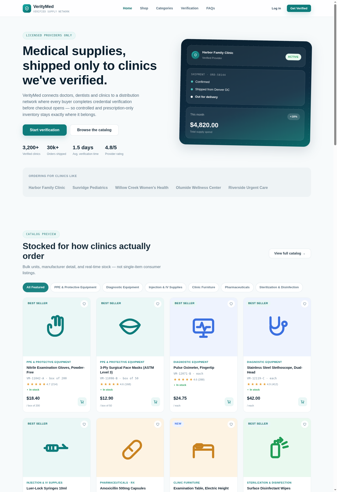

<table>
<tr><td align="center" width="30%">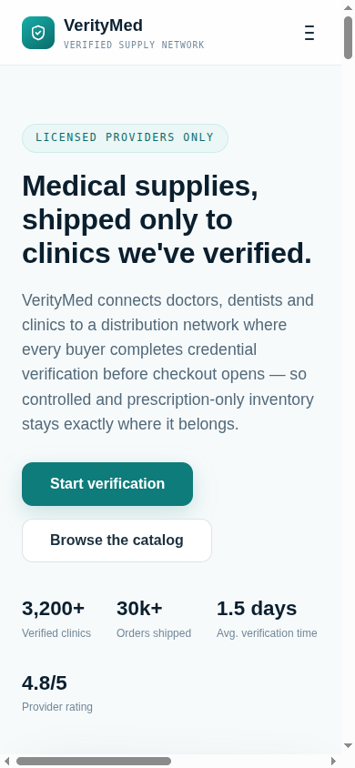<br><sub>Landing page — mobile viewport (390px)</sub></td>
<td valign="top">

The landing page covers the full marketing funnel in one scroll: hero with an animated shipment‑status preview card, an auto‑counting trust‑stats row, a filterable **featured products** strip, a **10‑category** grid, a 6‑card benefits section, a 4‑step **verification process** explainer, a **testimonials** grid, and an **FAQ accordion** — all backed by the same mock dataset used throughout the rest of the app, and all built to be fully responsive down to a 360px‑wide phone.

</td></tr>
</table>

### Authentication & onboarding

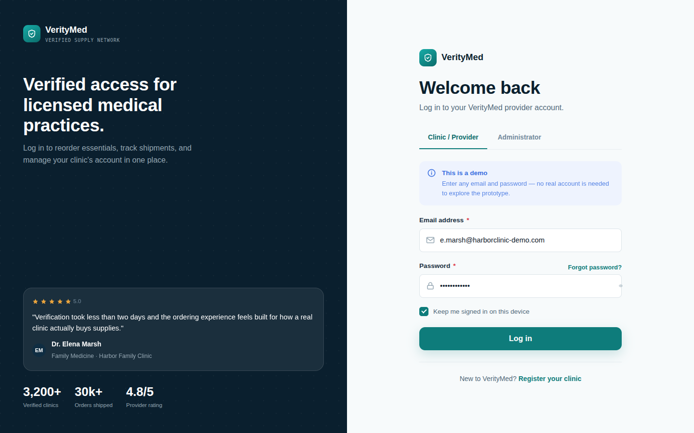
<p><sub>Split‑panel login with a <b>Clinic/Provider</b> vs <b>Administrator</b> tab (each routes to a different portal), password visibility toggle, and a live testimonial + trust stats panel.</sub></p>

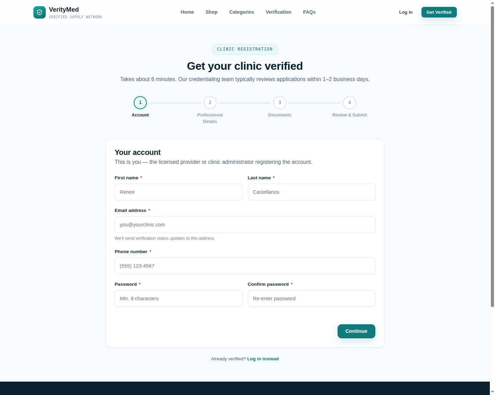
<p><sub>4‑step registration wizard — Account → Professional &amp; Clinic Details → Document Upload → Review &amp; Submit — with per‑step validation and a real drag‑and‑drop file uploader.</sub></p>

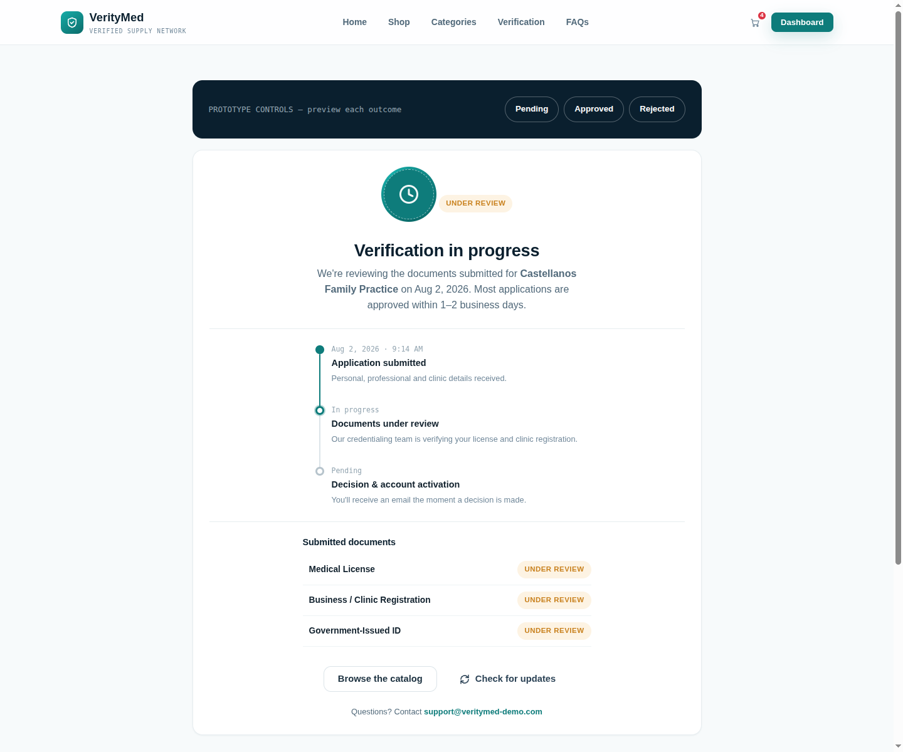
<p><sub>Post‑registration status page with a live‑style progress timeline. Includes a built‑in <b>Pending / Approved / Rejected</b> preview switcher so every outcome of the verification workflow can be inspected without needing a real backend to trigger it.</sub></p>

### Provider portal

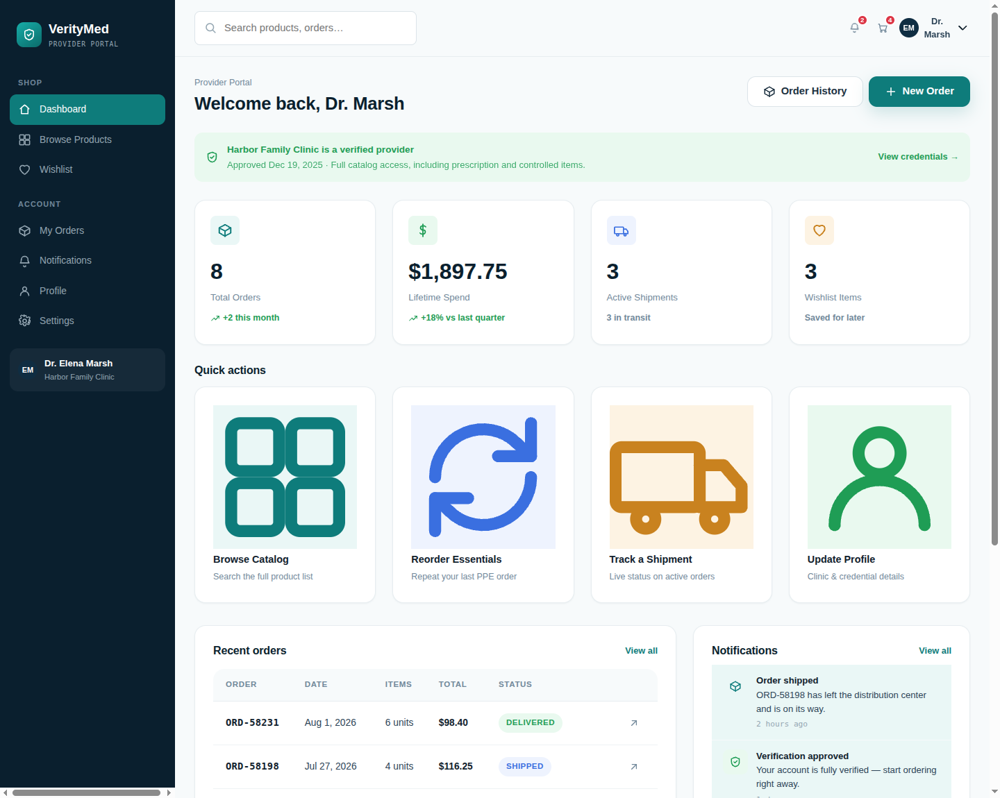
<p><sub>Signed‑in dashboard: verification status banner, 4 animated stat cards, quick actions, a recent‑orders table, a live notifications feed, and a volume‑pricing progress card.</sub></p>

### Store

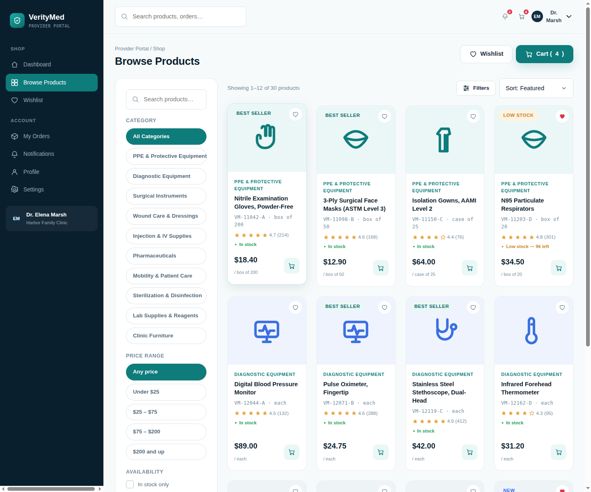
<p><sub>Full catalog with a sticky filter sidebar (category, price band, stock, prescription‑only), live search, sorting, pagination, and a skeleton‑loading state on first paint.</sub></p>

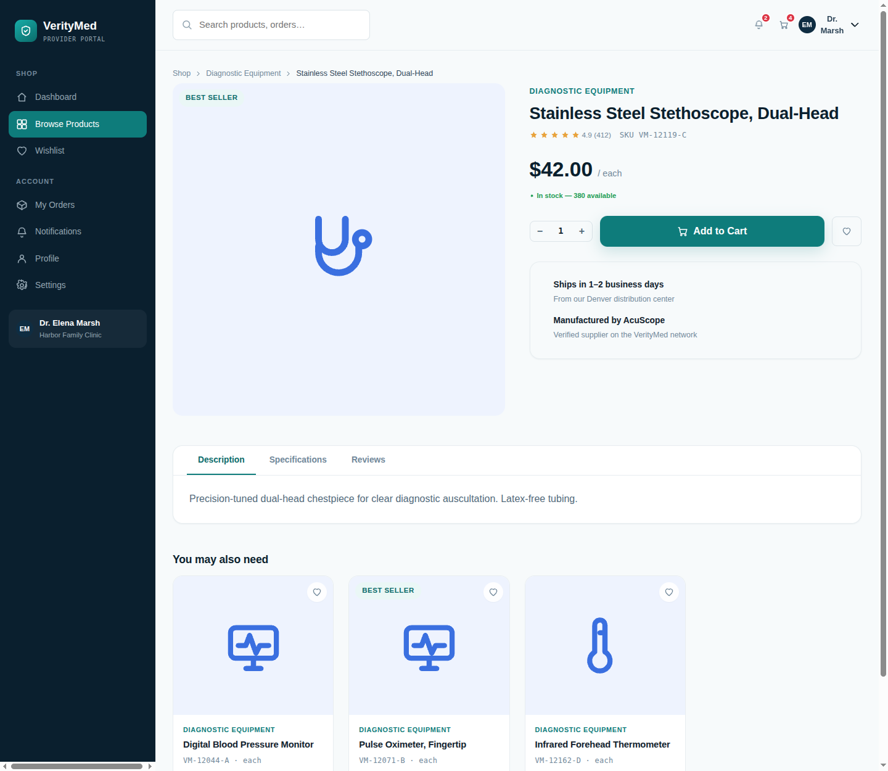
<p><sub>Product detail with a tabbed Description / Specifications / Reviews panel, quantity stepper, wishlist toggle, prescription‑item compliance notice, and related products.</sub></p>

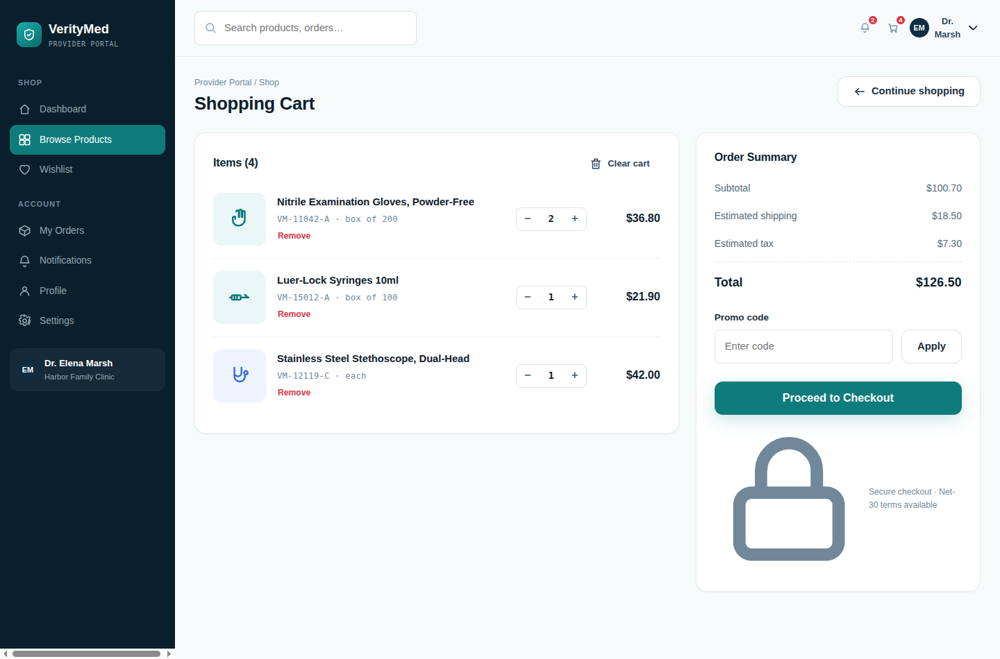
<p><sub>Cart with live quantity steppers, per‑item removal, promo code field, and a summary panel that recalculates shipping/tax/total in real time.</sub></p>

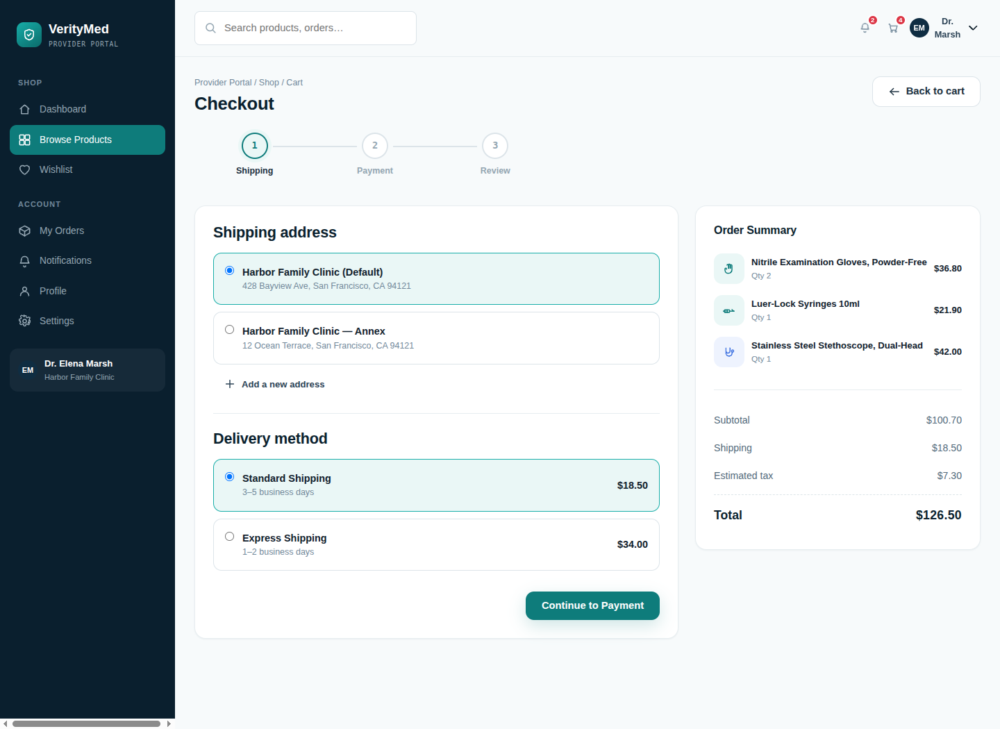
<p><sub>3‑step checkout — Shipping → Payment → Review — supporting saved addresses, Net‑30 purchase orders, card and ACH payment, with an order summary that persists across every step.</sub></p>

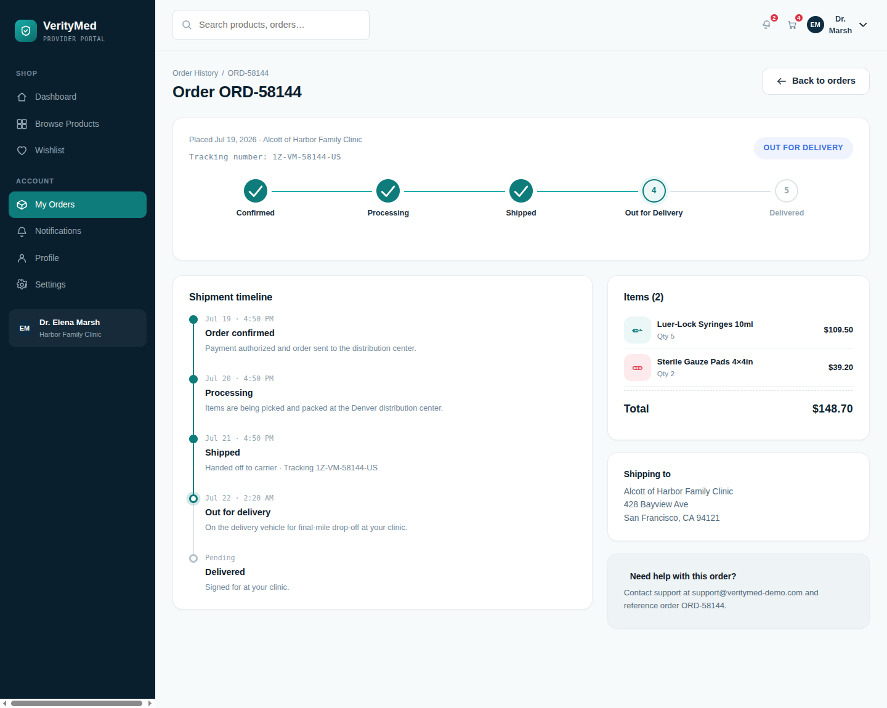
<p><sub>Order tracking with a horizontal shipment stepper and a detailed vertical timeline with timestamps, tied to the platform's shipment‑manifest visual language.</sub></p>

### Admin console

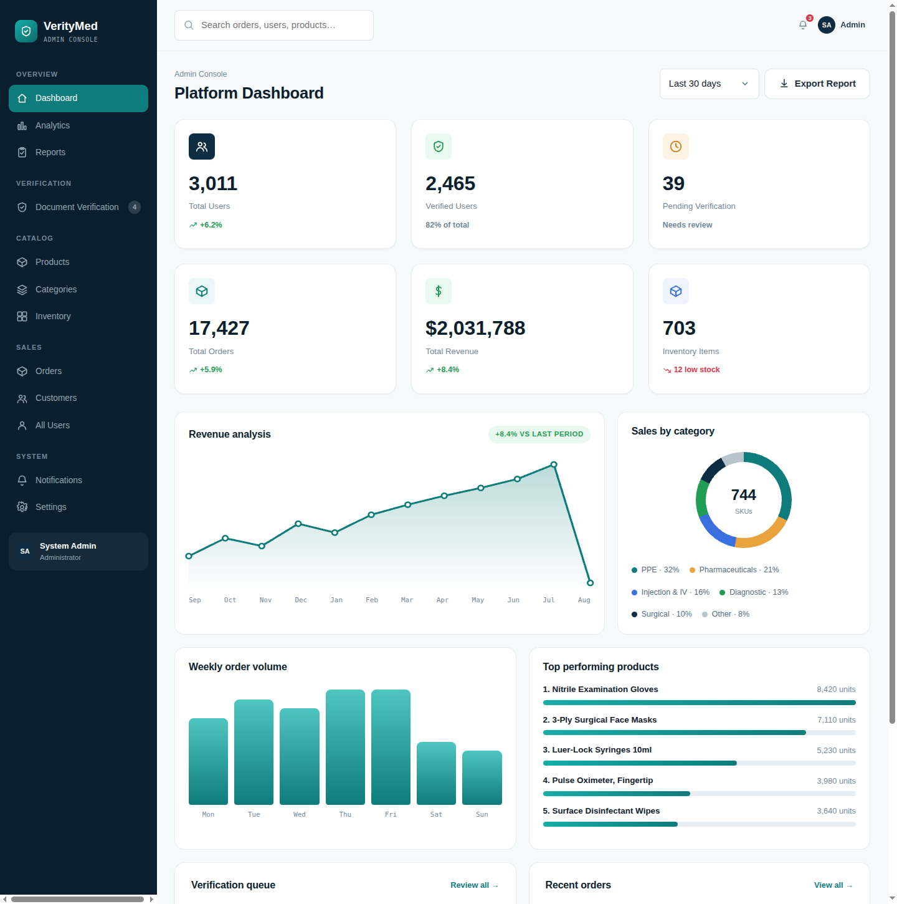
<p><sub>Admin overview: 6 KPI cards, a hand‑built animated revenue line chart, a category‑distribution donut chart, a weekly bar chart, top‑products progress bars, and live previews of the verification queue and recent orders.</sub></p>

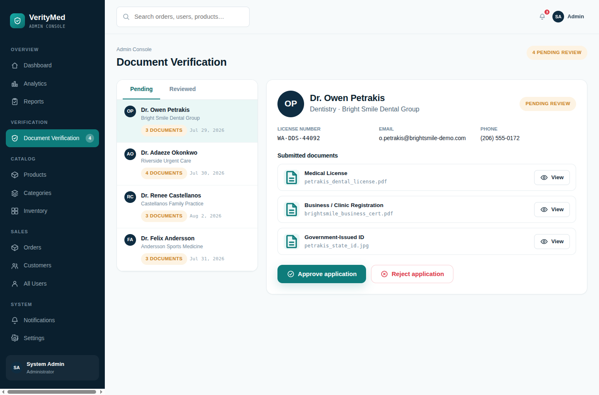
<p><sub>The core credentialing workflow: a pending‑applications queue, full applicant detail (license, contact info, submitted documents), and one‑click <b>Approve</b> / <b>Reject with reason</b> actions.</sub></p>

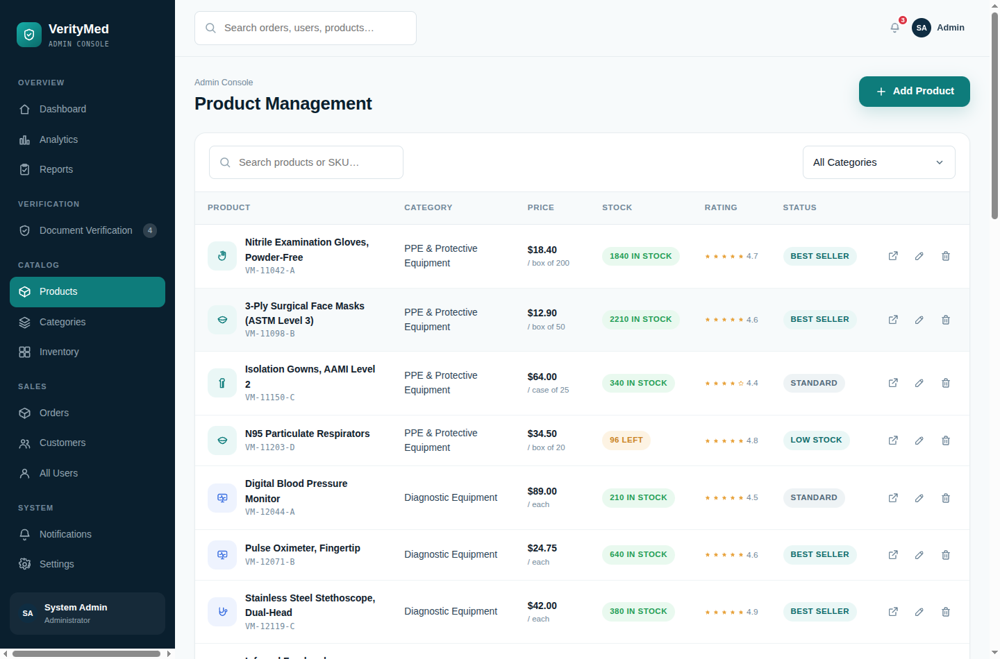
<p><sub>Catalog management with search/category filtering and a full add/edit product modal, all writing back into the live in‑memory catalog used by the storefront.</sub></p>

---

## Project structure

```text
medsupply/
├── assets/
│   ├── css/
│   │   └── style.css          # The entire design system: tokens, components, animations
│   ├── js/
│   │   ├── data.js            # All mock data + small data-formatting helpers
│   │   └── main.js            # Icon library, shared UI logic, rendering helpers
│   └── readme/
│       ├── banner.svg         # Animated SVG banner used at the top of this file
│       └── screenshots/       # Real captures used throughout this README
│
├── index.html                 # Landing page
├── login.html                 # Login (provider + admin tabs)
├── register.html              # 4-step clinic registration + document upload
├── forgot-password.html       # Password reset request + confirmation states
├── pending-verification.html  # Verification status (pending/approved/rejected)
│
├── dashboard.html              Provider dashboard
├── products.html                │  Catalog (search / filter / sort / pagination)
├── product-detail.html          │  Single product + related products
├── cart.html                    │  Shopping cart
├── checkout.html                │  3-step checkout
├── order-confirmation.html      │  Order success screen
├── orders.html                  │  Order history
├── order-tracking.html          │  Shipment tracking detail
├── wishlist.html                │  Saved products
├── profile.html                 │  Personal / clinic / credentials tabs
├── settings.html                │  Notifications, security, team, billing
├── notifications.html         # ┘ Provider portal (uses the app-shell layout)
│
├── admin-dashboard.html        Admin KPI dashboard + charts
├── admin-verification.html      │  Document review queue (approve/reject)
├── admin-users.html             │  All-user management
├── admin-customers.html         │  Customer / purchase-behavior management
├── admin-products.html          │  Product CRUD
├── admin-categories.html        │  Category CRUD
├── admin-inventory.html         │  Stock levels + adjustment
├── admin-orders.html            │  Order status management
├── admin-analytics.html         │  Funnel, growth & regional analytics
├── admin-reports.html           │  Report generation + history
├── admin-notifications.html     │  Admin notification center
├── admin-settings.html        # ┘ Platform / verification-rule / team settings
│
├── 404.html                   # Not-found error page
└── error-500.html             # Generic server-error page
```

49 files in total, all plain‑text and readable — no bundler, no minified output, no generated code.

---

## Full page directory

| # | Page | File | Description |
|---|------|------|--------------|
| 1 | Landing page | `index.html` | Hero, trust stats, featured products, categories, benefits, verification process, testimonials, FAQ |
| 2 | Login | `login.html` | Provider / Admin tabbed login, demo auto‑fill, password visibility toggle |
| 3 | Register | `register.html` | 4‑step registration wizard with document upload |
| 4 | Forgot password | `forgot-password.html` | Request + "check your email" confirmation state |
| 5 | Verification status | `pending-verification.html` | Pending / Approved / Rejected states with a live preview switcher |
| 6 | Dashboard | `dashboard.html` | Provider home: stats, quick actions, recent orders, notifications |
| 7 | Product catalog | `products.html` | Filterable, searchable, paginated storefront |
| 8 | Product detail | `product-detail.html` | Full product page with tabs and related items |
| 9 | Cart | `cart.html` | Editable cart with live totals |
| 10 | Checkout | `checkout.html` | 3‑step shipping/payment/review flow |
| 11 | Order confirmation | `order-confirmation.html` | Post‑purchase success screen |
| 12 | Order history | `orders.html` | Filterable list of past orders with reorder |
| 13 | Order tracking | `order-tracking.html` | Shipment timeline for a single order |
| 14 | Wishlist | `wishlist.html` | Saved products with "move all to cart" |
| 15 | Profile | `profile.html` | Personal info / clinic details / credentials tabs |
| 16 | Settings | `settings.html` | Notification prefs, security, team, billing, danger zone |
| 17 | Notifications | `notifications.html` | Full notification center with filters |
| 18 | Admin dashboard | `admin-dashboard.html` | Platform KPIs and charts |
| 19 | Document verification | `admin-verification.html` | Approve/reject credentialing queue |
| 20 | User management | `admin-users.html` | Search/filter/suspend/delete providers |
| 21 | Customer management | `admin-customers.html` | Purchase behavior, tiering, order summaries |
| 22 | Product management | `admin-products.html` | Catalog CRUD |
| 23 | Category management | `admin-categories.html` | Category CRUD |
| 24 | Inventory management | `admin-inventory.html` | Stock levels, reorder points, adjustments |
| 25 | Order management | `admin-orders.html` | Order status control |
| 26 | Analytics | `admin-analytics.html` | Revenue trend, funnel, category & regional performance |
| 27 | Reports | `admin-reports.html` | Generate + download report history |
| 28 | Admin notifications | `admin-notifications.html` | Platform‑level notification center |
| 29 | System settings | `admin-settings.html` | Platform, verification‑rule, and team settings |
| 30 | 404 | `404.html` | Not‑found error page |
| 31 | 500 | `error-500.html` | Generic server‑error page |

---

## Feature breakdown

### Public marketing site
- Hero with an animated "live shipment" preview card and four auto‑counting trust stats (`data-count-to`).
- Client‑side filterable **featured products** rail (category pills, no reload).
- 10‑category grid, each linking straight into the catalog pre‑filtered (`products.html?cat=...`).
- 4‑step "How verification works" explainer on a dark, dot‑grid section.
- Testimonial grid and an accordion FAQ, both data‑driven.
- Sticky header that collapses into a slide‑in mobile nav under 900px.

### Authentication & onboarding
- **Login** — a segmented control switches the destination between the Provider Portal and the Admin Console; either "log in" button simulates a network delay, shows a success toast, then redirects.
- **Register** — a 4‑step wizard (`Account → Professional & Clinic Details → Documents → Review`) with:
  - per‑step required‑field validation and inline error states,
  - a real drag‑and‑drop file dropzone (reads actual file name/size via the File API — nothing is uploaded anywhere),
  - a generated **Review** step that reflects everything entered in the previous steps before "submitting."
- **Forgot password** — request form that transitions into a "check your email" success state with a resend action.
- **Pending verification** — a status page with a route‑style progress timeline, list of submitted documents, and a **prototype control panel** that swaps between the Pending, Approved, and Rejected outcomes on demand, including a realistic rejection reason and a re‑upload call to action.

### Provider dashboard
- Verification banner, 4 animated KPI cards (orders, lifetime spend, active shipments, wishlist size).
- Quick‑action tiles (Browse catalog, Reorder essentials, Track a shipment, Update profile).
- Recent‑orders table and a live notifications panel, both sourced from the same data used on their dedicated pages.
- A volume‑pricing "tier progress" card illustrating automatic bulk‑discount tiers.

### Online store
- **Catalog** — search box, category/price/availability filters, 5 sort modes, 12‑per‑page pagination, a skeleton‑loading state on first paint, and an empty‑state with "clear filters."
- **Product detail** — image/media panel with badges, star ratings, stock status, a prescription‑item compliance notice, quantity stepper, add‑to‑cart with toast + micro‑animation, wishlist toggle, specs table, mock reviews, and related products.
- **Cart** — quantity steppers and per‑row removal wired through a single delegated event handler, a "clear cart" confirm dialog, promo code field, and a summary that recalculates shipping (free over $250) and 7.25% tax live.
- **Checkout** — 3‑step flow (saved addresses / delivery method → payment method incl. Net‑30 PO, card, ACH → review & place order) with a persistent order‑summary sidebar and a full loading‑state button before redirecting to confirmation.
- **Order confirmation** — a perforated "manifest ticket" summary, itemized totals, and a 4‑stage "what happens next" timeline.
- **Order history** — status tabs, a reorder action that re‑adds a past order's items to the cart, and invoice‑download stubs.
- **Order tracking** — a horizontal shipment stepper plus a detailed vertical timeline with generated timestamps, shipping address, and a support contact card.
- **Wishlist** — grid of saved products with "move all to cart" and per‑item removal via the heart toggle.

### Account & settings
- **Profile** — tabbed Personal Info / Clinic Details / Credentials, the latter showing all approved verification documents plus an additional‑document uploader.
- **Settings** — notification‑preference toggles, password + 2FA controls, a team‑members list with an invite action, billing methods (PO terms + saved card), and a danger‑zone account‑deactivation confirm dialog.
- **Notifications** — full‑page, filterable (All/Unread/Order/Verification/System) notification center with per‑item read‑state and "mark all as read."

### Admin console
- **Dashboard** — 6 KPI cards (users, verified users, pending verification, orders, revenue, inventory), a hand‑drawn animated revenue line chart, a category‑distribution donut chart, a weekly bar chart, a top‑products leaderboard, and live previews of the verification queue and recent orders.
- **Document verification** — a Pending/Reviewed queue, full applicant detail, per‑document "view" stub, one‑click **Approve**, and a **Reject** flow that opens a modal for a structured reason before moving the application to the Reviewed list.
- **User management** — searchable/filterable table with a detail modal, suspend/reactivate, edit stub, and delete with a destructive confirm dialog.
- **Customer management** — the verified‑customer subset viewed through a purchasing lens: auto‑computed spend tiers, sortable table, and a purchase‑history modal.
- **Product management** — full catalog CRUD via modal forms (add/edit/delete), writing directly into the same in‑memory `PRODUCTS` array the storefront renders from.
- **Category management** — card‑based CRUD with in‑use protection (a category with live products can't be deleted).
- **Inventory management** — stock KPIs, low‑stock/out‑of‑stock filters, and inline +/‑10 stock adjustment per SKU.
- **Order management** — status tabs, search, and a per‑row status‑change select that updates the order live.
- **Analytics** — revenue trend, category performance, a verification funnel (Registered → Documents Submitted → Verified → First Order) rendered as animated progress bars, verified‑user growth, and an orders‑by‑region breakdown.
- **Reports** — a generator (report type / date range / format) that appends a new row to a report‑history table with a simulated generation delay.
- **Settings** — platform info, verification rules (ID requirement, DEA requirement, auto‑flagging, SLA target), admin team & roles, notification routing, and a maintenance‑mode toggle behind a confirm dialog.

### Cross‑cutting UI states
Every one of the following is implemented and reachable, not just styled in isolation:
- **Loading** — full‑page loaders (dashboard, admin dashboard), button spinners (auth forms, checkout, report generation), and skeleton cards (catalog first paint).
- **Empty** — empty cart, empty wishlist, no‑search‑results, no‑orders‑in‑this‑status, no‑matching‑admin‑rows.
- **Success** — order confirmation, password‑reset‑sent, approval screens.
- **Error** — 404, 500, inline form validation, rejected verification.
- **Confirmation dialogs** — clear cart, delete user/product/category, deactivate account, enable maintenance mode.

---

## Design system

### Signature visual language
The whole product is unified by one idea — **medical distribution that verifies before it ships** — expressed through three recurring motifs:

| Motif | Where it shows up |
|---|---|
| **Verification seal** — a circular, conic‑gradient badge with a dashed inner ring | Hero panel, pending‑verification states, product detail's compliance notice, login page |
| **Manifest / ticket card** — a card with perforated‑edge notches and a dashed divider | Order confirmation |
| **Shipment route** — a dashed connector line with pulsing "current step" dots | Hero preview card, order tracking, README banner |

### Color tokens (`assets/css/style.css`)

| Token | Hex | Usage |
|---|---|---|
| `--navy-950` / `--navy-900` | `#0A1F2E` / `#0F2D42` | Dark sections, sidebars, footer |
| `--teal-600` / `--teal-500` | `#0E7C7B` / `#17ADA8` | Primary brand, buttons, links, focus states |
| `--amber-500` | `#E8A33D` | Pending / warning states, "Rx" accents |
| `--green-600` | `#1F9D55` | Verified / success states |
| `--red-600` | `#DC3545` | Errors / rejected / destructive actions |
| `--blue-600` | `#3A6FE0` | Informational badges |
| `--slate-50…900` | `#F7FAFB → #10202C` | Neutral text & surfaces |

### Typography
- **Space Grotesk** — headings and the wordmark (distinct, geometric).
- **Inter** — body copy and UI text.
- **IBM Plex Mono** — SKUs, order numbers, tracking codes, timestamps — a deliberate "packaging label" treatment that reinforces the supply‑chain theme.

### Components
A single stylesheet (`assets/css/style.css`, ~600 rules) implements every reusable piece: buttons (5 variants × 3 sizes), badges/status pills, cards, form controls (inputs, selects, checkboxes, radios, toggles, a real dropzone), a stepper, tables, tabs, a modal system, a toast system, an accordion, a kanban‑style column layout, pagination, tooltips, skeleton loaders, and empty states — all built from the same token set so no page ever "reinvents" a component.

### Animation library
Everything animates with intent rather than decoration: `fadeInUp`/`fadeInDown` for content entrances, a `stagger` utility for sequential card reveals, `pulseRing` for the "current step" indicator, `drawCheck`/`popScale` for success states, `dashMove` for the animated shipment route, `shimmer` for skeleton loaders, `bellRing` for unread notifications, and `growUp` for animated chart bars — all defined once in `style.css` and reused by class name everywhere.

---

## Architecture & how it works

This is a **static, multi‑page site** — every `.html` file is a real, independently‑loadable page (so links between pages work exactly like a real website, including on mobile). Three shared files do all the heavy lifting so individual pages stay small and consistent:

### `assets/js/data.js`
The single source of truth for every piece of content in the app: `PRODUCTS` (30 SKUs across 10 categories), `CATEGORIES`, `ORDERS`, `ADMIN_USERS`, `VERIFICATION_QUEUE`, `NOTIFICATIONS` / `ADMIN_NOTIFICATIONS`, `TESTIMONIALS`, `FAQS`, `ADMIN_METRICS`, and the chart datasets (`REVENUE_BY_MONTH`, `SALES_TREND`, `TOP_PRODUCTS`, `CATEGORY_DIST`), plus small formatting helpers. Changing what the app "contains" — adding a product, a user, an order — means editing one array in this file; every page that displays that data re‑renders it automatically because pages render *from* this data at load time instead of hard‑coding markup.

### `assets/js/main.js`
Everything interactive: a **60+ icon SVG library** (no icon font, no external request), the **cart & wishlist state** (in‑memory — see [Known limitations](#known-limitations-by-design)), **toast/modal/confirm‑dialog systems**, **chart renderers** that build bar/donut/line charts as plain SVG with no charting library, the **shared header/footer/app‑shell** renderers so every page gets identical navigation from a few lines of markup, and generic wiring (dropdowns, accordions, quantity steppers, file dropzones, scroll‑reveal, animated counters).

### `assets/css/style.css`
The full design system described above: tokens, layout primitives, every component, every animation, and all responsive breakpoints.

### The "app shell" pattern
Every signed‑in page (provider or admin) shares the same three‑part skeleton:

```html
<div class="app-shell">
  <aside class="app-sidebar" id="appSidebar"></aside>   <!-- filled by mountAppShell() -->
  <div class="app-main">
    <div class="app-topbar" id="appTopbar"></div>        <!-- filled by mountAppShell() -->
    <div class="app-content"> ...page-specific markup... </div>
  </div>
</div>
<script>
  mountAppShell('dashboard', 'user'); // or role: 'admin'
</script>
```

`mountAppShell(activeKey, role)` looks up the right navigation config (`USER_NAV` or `ADMIN_NAV`), injects the sidebar (highlighting the current page), injects the topbar (search box, notification bell with live unread count, account dropdown, cart icon), and wires up the mobile sidebar toggle — all from two lines per page. The public marketing pages use the lighter `renderPublicHeader()` / `renderFooter()` pair instead.

---

## Function reference

Every function below lives in `assets/js/main.js` unless noted, grouped by concern.

#### Icons & rendering helpers
| Function | Description |
|---|---|
| `icon(name, cls?)` | Returns an inline `<svg>` string for one of 60+ hand‑built line icons (`ICONS` map), optionally with an extra CSS class for animation (e.g. `bell-shake`). |
| `tintStyle(color)` | Returns an inline `background/color` style string for a token color (`teal`, `blue`, `green`, `amber`, `red`, `navy`) — used for category and stat‑card tinting. |
| `starsHTML(rating, count?)` | Builds a 5‑star rating widget (filled vs outline icons) with an optional review‑count label. |
| `qs(id)` / `getParam(name)` | Shorthand for `getElementById` and reading a URL query parameter (used for `product-detail.html?id=`, `order-tracking.html?id=`, etc.). |

#### Cart & wishlist state
| Function | Description |
|---|---|
| `cartCount()` / `cartSubtotal()` | Derive the total item count / dollar subtotal from the in‑memory `CART` array. |
| `updateCartBadges()` | Syncs every `.cart-badge-count` element on the page (header icon, sidebar, etc.) to the current count. |
| `addToCart(id, qty, btn?)` | Adds/increments a product in `CART`, updates badges, fires a success toast, and micro‑animates the button. |
| `removeFromCart(id)` / `updateCartQty(id, qty)` | Mutate the cart and re‑sync badges; pages that need to react (e.g. `cart.html`) hook in via `window.recalcCartPage`. |
| `toggleWishlist(id, btn?)` | Adds/removes a product from `WISHLIST`, swaps the heart icon, and fires a toast. |
| A delegated `document.addEventListener('click', …)` | Handles every `[data-qty]` stepper and `[data-remove-item]` button on the page generically, so cart/product rows need no per‑element wiring. |

#### Product rendering
| Function | Description |
|---|---|
| `productCardHTML(p)` | Returns the full markup for one product grid card (image tile, badges, wishlist button, rating, stock strip, price, add‑to‑cart). |
| `renderProductGrid(containerId, list)` | Renders an array of products into a container via `productCardHTML`. |
| `skeletonCards(n)` | Returns `n` shimmering skeleton placeholders, used while `products.html` "loads." |

#### Toasts, modals & dialogs
| Function | Description |
|---|---|
| `showToast({type, title, message, duration})` | Pushes a toast (`success`/`error`/`warning`/`info`) into a shared stack, auto‑dismissing with an exit animation. |
| `openModal(id)` / `closeModal(id)` | Toggle a `.modal-overlay` by id; wired globally to also close on overlay click, `[data-modal-close]`, and <kbd>Esc</kbd>. |
| `confirmAction({title, message, confirmLabel, danger, onConfirm})` | Dynamically builds and opens a confirm/cancel modal — used for every destructive action in the app (delete, deactivate, clear cart, enable maintenance mode). |

#### Navigation shell
| Function | Description |
|---|---|
| `renderPublicHeader(activeKey, loggedIn)` / `renderFooter()` | Build the marketing site's sticky header (with mobile nav drawer) and footer. |
| `mountAppShell(activeKey, role)` | Builds the sidebar + topbar for every signed‑in page from the `USER_NAV` / `ADMIN_NAV` config, wires the mobile sidebar toggle, and initializes dropdowns. |
| `initDropdowns()` / `closeAllDropdowns()` | Generic open/close wiring for any `[data-dropdown]` block (account menu, notification bell, table row actions). |
| `initFaqAccordion()` | Wires click‑to‑expand behavior for `.faq-item` blocks. |

#### Scroll effects & counters
| Function | Description |
|---|---|
| `initReveal()` | `IntersectionObserver`‑based fade/slide‑in for any `.reveal` element. |
| `initCounters()` / `animateCount(el)` | Animates any `[data-count-to]` element from 0 to its target value with easing, formatting, and optional prefix/suffix, once it scrolls into view. |

#### File uploads
| Function | Description |
|---|---|
| `initDropzone(dropId, inputId, listId)` | Wires click‑to‑browse and real drag‑and‑drop onto a styled dropzone. |
| `handleFiles(files, list)` | Reads real `File` objects (name/size via the browser File API) and renders removable file chips — nothing is ever uploaded anywhere. |

#### Charts (no charting library)
| Function | Description |
|---|---|
| `renderBarChart(id, data)` | Builds an animated CSS‑bar chart from `{label, value}` pairs. |
| `renderDonut(id, data, centerVal, centerLabel, size?)` | Builds a multi‑segment SVG donut chart with a legend, using `stroke-dasharray` math — no canvas, no library. |
| `renderLineChart(id, data, color?, height?)` | Builds a smoothed SVG line/area chart with gradient fill and point markers. |

#### Notifications
| Function | Description |
|---|---|
| `notifIconInfo(type)` / `notifItemHTML(n)` | Map a notification's type (`order`/`verification`/`promo`/`system`) to an icon + tint, and render one notification row — shared between the header dropdown and the full notification‑center pages. |

#### Data helpers (`assets/js/data.js`)
| Function | Description |
|---|---|
| `getProduct(id)` / `getCategory(id)` | Look up a product or category by id from the mock dataset. |
| `fmtMoney(n)` / `fmtMoneyShort(n)` | Currency formatting (`$1,234.50` vs `$1,234`). |
| `fmtDate(d)` | Formats an ISO date string as `Aug 9, 2026`. |
| `orderItemsTotal(order)` | Sums an order's line items from current product prices. |

---

## Getting started

No installation, no build step, no server required.

**Option 1 — just open it**
Download/unzip the project and double‑click `index.html` (or any other page) to open it in your browser. Every internal link (`<a href="products.html">`, etc.) works exactly as it would on a real host, because this *is* a real static multi‑page site.

**Option 2 — serve it locally** (recommended, avoids any browser `file://` quirks)
```bash
# Python 3
cd medsupply
python3 -m http.server 8080
# then open http://localhost:8080

# or, with Node.js installed
npx http-server medsupply -p 8080
```

There is nothing to `npm install` — the only external network calls the pages make are optional Google Fonts requests (the design degrades gracefully to system fonts if you're offline).

---

## Testing & quality assurance

Although this is a static prototype, it was validated like a real application before delivery:

- **Static checks** — every inline `<script>` block across all 31 pages was extracted and syntax‑checked with Node, every internal link was verified to resolve to a real file, and every `id` referenced by `getElementById`/`qs()` was confirmed to exist.
- **Headless DOM execution** — every page was loaded in `jsdom` with scripts running "dangerously" to catch runtime errors (undefined variables, null references) that only surface when the page actually executes.
- **Interaction testing** — a second harness simulated real user flows (filtering the catalog, stepping through checkout and registration, approving/rejecting a verification application, editing a product, toggling settings, etc.) and asserted zero runtime errors.
- **Real browser rendering** — every screenshot in this README is a genuine capture (Electron + Chromium, headless via Xvfb) of the actual page, not a redrawn mockup, which incidentally also shook out a couple of real bugs (a stale DOM reference, a race condition in a batch script) that were fixed as a result.

---

## Known limitations (by design)

This is a **frontend prototype**, and a few things are intentionally simplified so the project stays dependency‑free and safe to open from a plain file:

- **No backend, no database, no real auth.** Login accepts any email/password; "sessions" don't persist.
- **No persistent storage.** Cart, wishlist, and any edits made in the admin console (adding a product, approving an application, etc.) live in memory for the current page only and reset on reload/navigation — there is deliberately no `localStorage`/`sessionStorage` use, so the same demo state is guaranteed every time a page is opened.
- **Shared demo identity.** Every signed‑in page assumes the same demo user (Dr. Elena Marsh, Harbor Family Clinic) and the same demo admin, so the whole journey is coherent without a login system behind it.
- **File uploads are simulated.** The document dropzones use the real browser File API (so file name/size are genuine), but nothing is ever transmitted anywhere.
- **Some admin actions are stubs** (e.g. inviting a team member, editing user roles, adding a payment method) and surface an honest "demo prototype" toast rather than silently pretending to succeed.

---

## Roadmap to a real backend

If this prototype were to become a production app, the natural next steps would be:

1. Replace `data.js` with real API calls (REST/GraphQL) behind each page's render step.
2. Add real authentication/session handling and role‑based route protection.
3. Wire the document dropzones to genuine file storage + a virus/format scan step.
4. Move cart/wishlist state to a persisted, per‑user store.
5. Replace the hand‑rolled SVG charts with a data‑bound charting library once real time‑series data exists.
6. Add real payment processing (the checkout UI already models PO/Net‑30, card, and ACH as first‑class options).

---

## License

This project is released under the **MIT License** — see below. All company names, people, clinics, products, and figures throughout the app (VerityMed, Harbor Family Clinic, Dr. Elena Marsh, etc.) are **fictional placeholder content** created for demonstration purposes only and do not represent real entities.

```
MIT License

Copyright (c) 2026

Permission is hereby granted, free of charge, to any person obtaining a copy
of this software and associated documentation files (the "Software"), to deal
in the Software without restriction, including without limitation the rights
to use, copy, modify, merge, publish, distribute, sublicense, and/or sell
copies of the Software, subject to the following conditions:

The above copyright notice and this permission notice shall be included in
all copies or substantial portions of the Software.

THE SOFTWARE IS PROVIDED "AS IS", WITHOUT WARRANTY OF ANY KIND, EXPRESS OR
IMPLIED, INCLUDING BUT NOT LIMITED TO THE WARRANTIES OF MERCHANTABILITY,
FITNESS FOR A PARTICULAR PURPOSE AND NONINFRINGEMENT.
```

<div align="center">
<sub>Built as a frontend prototype to document product UX before backend development begins.</sub>
</div>
